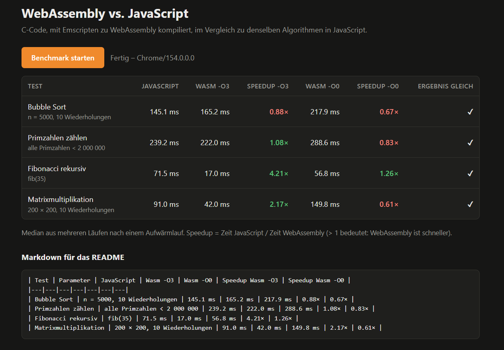

# WebAssembly vs. JavaScript – C mit Emscripten

Aufgabe aus *Current Technologies*, Einheit „Web Assembly“ (MCI).

Rechenintensive Funktionen werden in **C** geschrieben, mit **Emscripten** zu **WebAssembly** kompiliert
und im **Browser** sowie in **Node.js** ausgeführt. Dieselben Algorithmen sind 1:1 in **JavaScript**
implementiert; die Ausführungszeiten werden verglichen.

  **Live-Demo:** https://mimo3a.github.io/wasm-vs-js-benchmark/web/

## Inhalt

```
src/bench.c         rechenintensive Funktionen in C
js/bench.js         dieselben Funktionen in JavaScript
js/runner.js        gemeinsame Benchmark-Logik (Aufwärmlauf, 5 Läufe, Median, Ergebnisvergleich)
web/index.html      Benchmark im Browser (Tabelle mit Zeiten und Speedup)
node/run.mjs        Benchmark in Node.js (Konsole + Markdown-Tabelle)
example/            kleines Einstiegsbeispiel: add/subtract als Rechner im Browser
build.ps1           Build unter Windows (PowerShell + Docker)
build.sh            Build unter Linux/macOS (lokales emcc oder Docker)
build/              erzeugte Dateien (.wasm + JavaScript glue code .mjs)
```

### Benchmarks

| Test | Was wird gemessen | Komplexität |
|---|---|---|
| Bubble Sort | 5000 Zufallszahlen sortieren, 10 Wiederholungen | O(n²) |
| Primzahlen zählen | Probedivision für alle Zahlen < 2 000 000 | O(n·√n) |
| Fibonacci rekursiv | `fib(35)`, ca. 30 Mio. Funktionsaufrufe | O(2ⁿ) |
| Matrixmultiplikation | 200 × 200 `double`-Matrizen, 10 Wiederholungen | O(n³) |

Damit der Vergleich fair ist:

- Die Eingabedaten werden **innerhalb** jeder Implementierung mit demselben Zufallsgenerator (LCG, fester Seed)
  erzeugt – es werden keine großen Arrays zwischen JavaScript und WebAssembly kopiert.
- Jede Funktion liefert eine Prüfsumme. So entfernt der Compiler die Berechnung nicht als toten Code,
  und es wird geprüft, dass Wasm und JS **dasselbe Ergebnis** liefern.
- Pro Test gibt es einen Aufwärmlauf (JIT-Compiler), danach 5 gemessene Läufe; verwendet wird der **Median**.
- WebAssembly wird zweimal gebaut: optimiert (`-O3`) und unoptimiert (`-O0`), um den Einfluss
  der Compiler-Optimierung zu zeigen.

## Build

Voraussetzung: **Docker Desktop** (Emscripten wird über das Image `emscripten/emsdk` verwendet, keine Installation nötig).

Windows (PowerShell, im Projektordner):

```powershell
.\build.ps1
# falls Skripte blockiert sind:
powershell -ExecutionPolicy Bypass -File .\build.ps1
```

Linux / macOS:

```sh
./build.sh
```

Der eigentliche Compiler-Aufruf (wie in der Vorlesung):

```sh
docker run --rm -v "$(pwd):/src" -w /src emscripten/emsdk \
  emcc src/bench.c -O3 -o build/bench.mjs \
  -sEXPORTED_FUNCTIONS=_bubble_sort_bench,_count_primes,_fib,_matmul_bench
```

- `--rm` löscht den Container nach dem Lauf, `-v` mountet den Projektordner nach `/src`.
- Die Endung bei `-o` bestimmt die Ausgabe: `.mjs` → `.wasm` + JavaScript glue code als ES-Modul,
  `.wasm` → nur die Binärdatei.
- `EXPORTED_FUNCTIONS` ist nötig, weil es kein `main` gibt: ohne diese Angabe entfernt die
  Dead-Code-Elimination alle Funktionen. Die Namen bekommen einen Unterstrich.

## Ausführen

### Browser

Die Seite muss über einen Webserver geöffnet werden (`fetch` der `.wasm`-Datei funktioniert nicht mit `file://`).
Im **Projektordner** (nicht in `web/`):

```sh
python -m http.server 8000
# oder: npx serve .
```

- Benchmark: <http://localhost:8000/web/>
- Einstiegsbeispiel (Rechner): <http://localhost:8000/example/>

### Node.js (ab Version 18)

```sh
node node/run.mjs
```

Die Ausgabe enthält am Ende eine Markdown-Tabelle, die direkt unten eingefügt werden kann.

## Einbindung von WebAssembly

Verwendet wird der **JavaScript glue code** von Emscripten – laut Vorlesung die empfohlene Variante,
weil er die `.wasm`-Datei selbst lädt und Hilfsfunktionen (z. B. für Strings) mitbringt:

```js
import createModule from '../build/bench.mjs';
const m = await createModule();
m._fib(35);            // exportierte C-Funktion, mit Unterstrich
```

Die direkte Variante ohne glue code ist im Einstiegsbeispiel (`example/index.html`) als Kommentar gezeigt:

```js
const { instance } = await WebAssembly.instantiateStreaming(fetch('../build/math_standalone.wasm'), {});
instance.exports.add(1, 2);   // ohne Unterstrich
```

## Ergebnisse

**System:** Intel Core i9, Windows · Median aus 5 Läufen nach einem Aufwärmlauf



**Browser (Chrome 154):**

| Test | Parameter | JavaScript | Wasm -O3 | Wasm -O0 | Speedup Wasm -O3 | Speedup Wasm -O0 |
|---|---|---|---|---|---|---|
| Bubble Sort | n = 5000, 10 Wiederholungen | 145.1 ms | 165.2 ms | 217.9 ms | 0.88× | 0.67× |
| Primzahlen zählen | alle Primzahlen < 2 000 000 | 239.2 ms | 222.0 ms | 288.6 ms | 1.08× | 0.83× |
| Fibonacci rekursiv | fib(35) | 71.5 ms | 17.0 ms | 56.8 ms | 4.21× | 1.26× |
| Matrixmultiplikation | 200 × 200, 10 Wiederholungen | 91.0 ms | 42.0 ms | 149.8 ms | 2.17× | 0.61× |

**Node.js v24.11.1:**

| Test | Parameter | JavaScript | Wasm -O3 | Wasm -O0 | Speedup Wasm -O3 | Speedup Wasm -O0 |
|---|---|---|---|---|---|---|
| Bubble Sort | n = 5000, 10 Wiederholungen | 120.5 ms | 237.5 ms | 247.6 ms | 0.51× | 0.49× |
| Primzahlen zählen | alle Primzahlen < 2 000 000 | 244.5 ms | 210.2 ms | 325.7 ms | 1.16× | 0.75× |
| Fibonacci rekursiv | fib(35) | 68.1 ms | 15.7 ms | 71.9 ms | 4.33× | 0.95× |
| Matrixmultiplikation | 200 × 200, 10 Wiederholungen | 91.5 ms | 41.2 ms | 163.6 ms | 2.22× | 0.56× |

Speedup = Zeit JavaScript / Zeit WebAssembly (> 1 → WebAssembly ist schneller).
In allen Tests liefern WebAssembly und JavaScript identische Ergebnisse (Prüfsummen).

## Interpretation

- **Fibonacci (≈ 4,2–4,3×)** und **Matrixmultiplikation (≈ 2,2×)**: Optimiertes WebAssembly ist klar schneller.
  Viele Funktionsaufrufe und Gleitkomma-Schleifen profitieren von der Optimierung beim Kompilieren.
- **Primzahlen (≈ 1,1×)**: Bei einfachen Integer-Schleifen ist der Unterschied gering – der JIT-Compiler
  von V8 optimiert solchen Code zur Laufzeit fast genauso gut.
- **Bubble Sort (0,51–0,88×)**: JavaScript ist hier schneller. Da `-O3` und `-O0` nahe beieinander liegen,
  ist der Engpass vermutlich die schwer vorhersagbare Verzweigung beim Vergleich zufälliger Werte,
  nicht die Anzahl der Instruktionen. Für diesen Fall erzeugt der JIT von V8 effizienteren Maschinencode.
- **Browser und Node.js** zeigen dasselbe Bild – beide verwenden die JavaScript-Engine V8.
- **Unoptimiertes WebAssembly (`-O0`)** ist fast überall langsamer als JavaScript; `-O3` ist bis zu 3,6× schneller
  als `-O0`. Der Vorteil entsteht also nicht automatisch durch das Format, sondern durch den optimierenden Compiler.
- **Fazit:** WebAssembly lohnt sich vor allem für rechenintensive Aufgaben mit vielen Funktionsaufrufen oder
  Gleitkomma-Arithmetik. Bei einfachem Code ist modernes JavaScript oft gleichwertig – man sollte messen,
  statt pauschal von „Wasm ist schneller“ auszugehen.